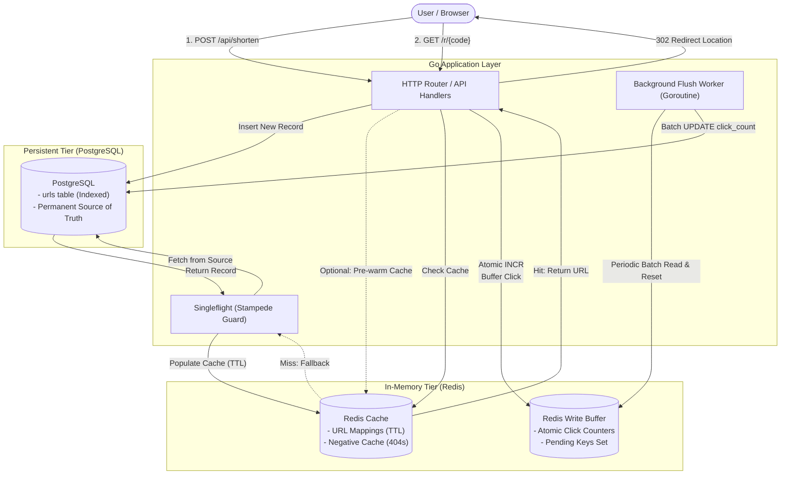
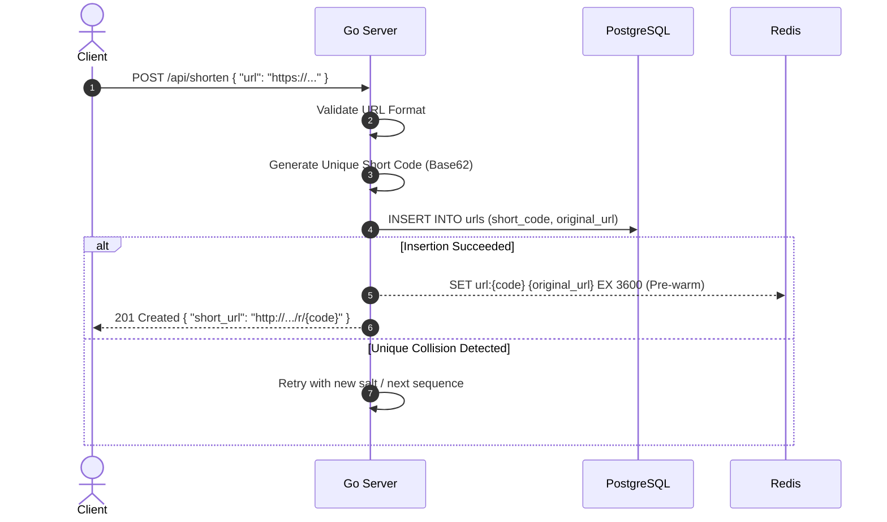
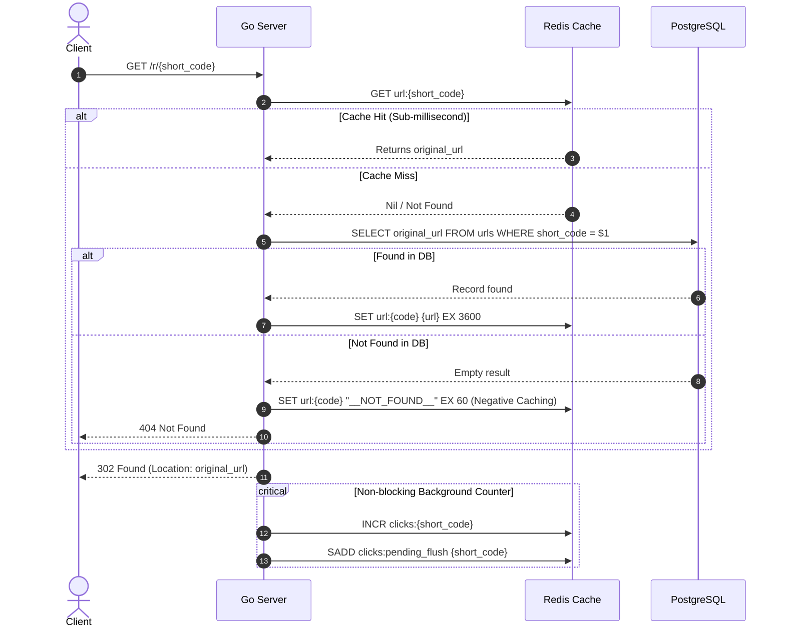
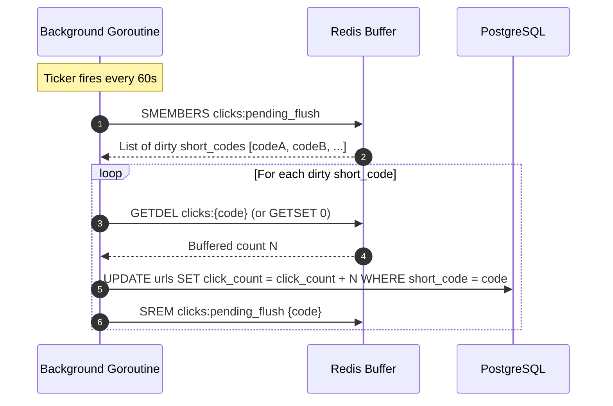

# System Architecture: High-Performance URL Shortener

## 1. Executive Summary

This document outlines the system architecture for a high-performance, low-latency URL Shortener service built with **Go**, **PostgreSQL**, and **Redis**. 

The service is engineered to achieve:
- **Sub-millisecond read latency** for high-volume redirects via in-memory caching.
- **Relational durability & data integrity** using PostgreSQL as the persistent source of truth.
- **Write-behind buffer pattern** to shield the relational database from high-frequency click analytics writes during traffic spikes.
- **Protection against common distributed cache anomalies** (Cache Penetration, Cache Stampede).

---

## 2. High-Level Architecture Diagram



---

## 3. Data Tier Specifications

### 3.1. PostgreSQL: Relational Source of Truth

PostgreSQL holds permanent records. It ensures that even if the Redis cache is entirely evicted or restarted, every link mapping and historical count remains intact.

#### Schema: `urls` Table
```sql
CREATE TABLE IF NOT EXISTS urls (
    id BIGSERIAL PRIMARY KEY,
    short_code VARCHAR(10) NOT NULL UNIQUE,
    original_url TEXT NOT NULL,
    click_count BIGINT NOT NULL DEFAULT 0,
    created_at TIMESTAMPTZ NOT NULL DEFAULT NOW(),
    updated_at TIMESTAMPTZ NOT NULL DEFAULT NOW()
);

-- B-Tree index on short_code for O(log N) lookups on cache misses
CREATE UNIQUE INDEX IF NOT EXISTS idx_urls_short_code ON urls(short_code);
```

---

### 3.2. Redis: Dual-Purpose In-Memory Store

Redis operates in two distinct functional roles:

#### Role A: Read Cache (Cache-Aside Pattern)
* **Key Format:** `url:{short_code}`
* **Type:** String
* **Value:** `https://example.com/very/long/destination/url`
* **TTL Policy:** Expire after 1 to 24 hours (`EX 3600`).
* **Negative Cache Key:** Same key format, but value set to empty sentinel `__NOT_FOUND__` with a short 60-second TTL to block repetitive brute-force requests for invalid short codes.

#### Role B: Write Buffer (Click Analytics Aggregation)
* **Counter Key:** `clicks:{short_code}` (Type: Integer / String counter incremented via `INCR`)
* **Dirty Tracking Set:** `clicks:pending_flush` (Type: Set of `short_code` strings). Every time a short code gets an increment, its code is added to this set (`SADD`) so the background worker knows exactly which keys have updates without scanning the entire Redis database.

---

## 4. Core Workflows & Logic

### 4.1. URL Shortening (Creation Path)



#### Short Code Generation Strategies:
1. **Base62 Encoding on Auto-Increment Sequence:** Highly efficient and compact, guaranteed collision-free, but predictable (users can guess next URLs).
2. **Cryptographic Random 6-8 Characters:** Uses characters `[a-zA-Z0-9]` ($62^6 \approx 56.8 \text{ billion}$ combinations). Requires checking collisions against PostgreSQL unique constraints.
3. **MD5 / SHA-256 Truncation with Collision Resolution:** Fast, deterministic, but requires salt if two users shorten the same link.

---

### 4.2. Redirection & Click Buffering (Read Path)



---

### 4.3. Write-Behind Analytics Flush (Background Worker)

Rather than writing to disk synchronously on every click, a Go goroutine periodically executes a batch synchronization job:



#### Why `GETDEL` or Atomic Swaps Matter:
A naive `GET clicks:xyz` followed by `DEL clicks:xyz` creates a race condition: any clicks occurring between the `GET` and `DEL` operations would be wiped and lost forever. 
Using Redis **`GETDEL`** (available in modern Redis) or an atomic Lua script / `GETSET 0` ensures zero count loss under concurrent load.

---

## 5. Resilience & Edge-Case Engineering

### 5.1. Cache Stampede (Dogpiling Protection)
* **The Risk:** If a heavily accessed celebrity link expires from Redis, thousands of concurrent requests might simultaneously experience a cache miss and all query PostgreSQL at the exact same millisecond, overloading the database.
* **The Solution:** In Go, use **`golang.org/x/sync/singleflight`**. It deduplicates in-flight database requests for the same key, ensuring only *one* goroutine queries PostgreSQL while all other concurrent requests wait and share the single result.

### 5.2. Cache Penetration Protection
* **The Risk:** An attacker floods the service with randomized, non-existent short codes (`/r/fake1`, `/r/fake2`, etc.). Because none exist in the cache, every single request bypasses Redis and hammers PostgreSQL.
* **The Solution:**
  1. **Negative Caching:** When a code is confirmed missing in PostgreSQL, store a placeholder key with a short TTL (e.g., 60 seconds) in Redis.
  2. **Code Format Validation:** Reject requests at the router level if the short code violates expected alphanumeric regex rules before touching Redis or the database.

### 5.3. Graceful Shutdown & Drain
* When the Go application receives an interrupt signal (`SIGINT`, `SIGTERM`):
  1. Stop accepting new incoming HTTP requests.
  2. Complete active in-flight requests.
  3. Execute one final synchronization flush of all pending Redis click counters to PostgreSQL before exiting.

---

## 6. HTTP API Specification

| Endpoint | Method | Status Codes | Description |
| :--- | :--- | :--- | :--- |
| `/api/shorten` | `POST` | `201 Created`<br>`400 Bad Request` | Submits long URL, returns generated short URL payload. |
| `/r/{short_code}` | `GET` | `302 Found`<br>`404 Not Found` | Redirects to destination URL and registers click. |
| `/api/urls/{short_code}` | `GET` | `200 OK`<br>`404 Not Found` | Retrieves link statistics (original URL, total clicks, creation date). |
| `/healthz` | `GET` | `200 OK`<br>`503 Service Unavailable` | Liveness/readiness probe checking DB & Redis connectivity. |

---

## 7. Recommended Go Library Ecosystem

* **HTTP Router:** Standard library `net/http` or lightweight `github.com/go-chi/chi/v5`
* **PostgreSQL Driver & Pool:** `github.com/jackc/pgx/v5` with connection pooling (`pgxpool`)
* **Redis Client:** `github.com/redis/go-redis/v9`
* **Stampede Guard:** `golang.org/x/sync/singleflight`
* **Config Management:** Environment variables via standard library `os.Getenv` or `github.com/joho/godotenv`
